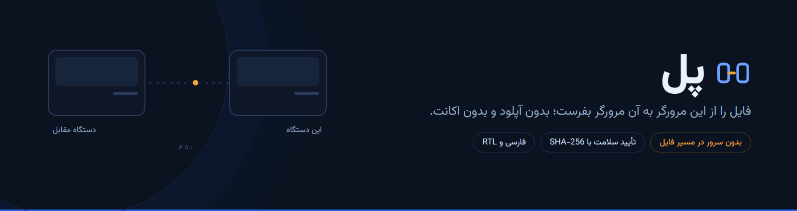

<div align="center">
  
</div>

# Pol

Send a file straight from one browser to another. Pick a file, get four words, hand them to the other side, and the transfer starts. Bytes travel over a WebRTC data channel: nothing is uploaded, no account is needed, and the server never holds the file.

**Live demo:** https://qqsp.ir/ — the page and the signaling server are the same origin, so there is nothing to configure.

## What it does

- **Four-word code** — four Persian words from a 64-word list, easy to read over the phone and type on a mobile keyboard.
- **Direct transfer** — file bytes only use the data channel. The signal server introduces the two browsers and relays SDP/ICE; it never sees the file.
- **Integrity check** — SHA-256 is computed while streaming, so a 2 GB file does not need 2 GB of RAM. The receiver hashes what it gets and compares.
- **Persian and RTL** — right-to-left interface, light and dark themes, Vazirmatn bundled locally. No external CDN.

## Run it

Requires Node 20 or newer.

```bash
npm install
npm run dev:signal   # terminal 1: signaling server on 8787
npm run dev          # terminal 2: client on 5173
```

Open two tabs, drop a file in one, type the code in the other.

For a deployment build, point it at your signaling server:

```bash
VITE_SIGNAL_URL=wss://example.com/signal npm run build
```

Add STUN/TURN when the two devices are not on the same network:

```bash
VITE_ICE='[{"urls":"stun:stun.example.com:3478"}]' npm run build
```

```bash
npm test        # 26 tests: word codes, file sizes, SHA-256 vectors
npm run build   # typecheck + production build
```

## How it works

```
index.html          one page, no UI framework
src/lib/            pure logic: word code, SHA-256, formatting
src/net/            signaling client and WebRTC transfer
server/signal.mjs   rooms and SDP/ICE relay (~150 lines)
```

The sender creates a data channel and offers; the receiver answers. Files are sliced into 64 KB chunks with backpressure at 4 MB buffered, then verified with SHA-256. A room code is only a room identifier — encryption comes from DTLS, and a key derived from the code (SPAKE2) is planned for v0.7.

Known limits:

- Without STUN/TURN, both devices must share a network or sit behind a simple NAT.
- One file per session; folders and resume-after-disconnect are not built yet.
- The file is assembled in the tab's memory, so multi-gigabyte transfers are not practical yet.
- If the signal server is malicious it could theoretically sit in the middle. The code does not protect against that yet.

## فارسی

**پل** یک ایردراپ مرورگری است: فایل را روی یک دستگاه انتخاب می‌کنی، یک کد چهارکلمه‌ای می‌گیری، طرف مقابل کد را می‌زند و فایل مستقیم بین دو مرورگر جابه‌جا می‌شود. هیچ فایلی آپلود نمی‌شود و هیچ اکانتی لازم نیست.

دموی زنده: https://qqsp.ir/

```bash
npm install
npm run dev:signal   # ترمینال اول
npm run dev          # ترمینال دوم
```

- کد چهارکلمه‌ای فقط شناسهٔ اتاق است، نه رمز. رمزنگاری از خود WebRTC می‌آید.
- بدون STUN/TURN فقط شبکهٔ محلی یا NAT ساده جواب می‌دهد.
- هر نشست یک فایل؛ پوشه و ادامهٔ انتقال بعد از قطعی هنوز نیست.
- فایل در حافظهٔ تب جمع می‌شود؛ برای فایل چند گیگابایتی مناسب نیست.
- سلامت فایل با SHA-256 بررسی می‌شود و در پایان، نتیجه روی هر دو طرف دیده می‌شود.

## License

MIT
