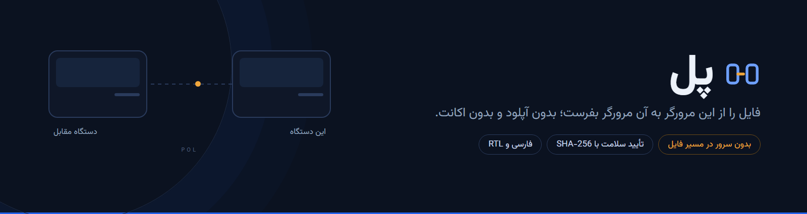

<div align="center">
  
</div>

# Pol

Send a file straight from one browser to another. Pick a file, get four words, hand them to the other side, and the transfer starts. Bytes travel over a WebRTC data channel: nothing is uploaded, no account is needed, and the server never holds the file.

**Live demo:** https://qqsp.ir/ — the page and the signaling server are the same origin, so there is nothing to configure.

> **Same network: direct and unlimited. Different networks: relayed, up to 200 MB.** When both devices share a network the transfer is direct with no size cap. Across networks the traffic goes through a TURN relay, and relay transfers are capped at 200 MB for now.

## What it does

- **Multi-file sessions** — the room stays open after a transfer: drop the next file and it rides the same connection, no new code. Both sides keep a per-session list with sizes and a total, and the sender sees an ETA while a file is in flight.
- **Text & clipboard** — paste or type a snippet and send it: the receiver reads it inline and copies it back with one click.
- **Folders as streaming ZIP** — pick a folder (or drop one), it becomes a ZIP sent as it is built: files stream through the CRC into 64 KB chunks, nothing is held in memory whole.
- **Resume after a drop** — the receiver writes incoming bytes to the browser's private file system (OPFS), so a multi-gigabyte file never sits in the tab's memory. If the connection dies — or the receiver's page is reloaded — the next attempt continues from the stored byte count, and the final SHA-256 still covers the whole file.
- **QR handoff** — the code card carries a QR of the room link, so a phone scans it and lands in the same room. The encoder is built in; no QR library is shipped.
- **Installable** — a manifest and a service worker make Pol installable, and the app shell opens without a network.
- **Four-word code** — four Persian words from a 64-word list, easy to read over the phone and type on a mobile keyboard.
- **Direct transfer** — file bytes only use the data channel. The signal server introduces the two browsers and relays SDP/ICE; it never sees the file.
- **Integrity check** — both sides hash while the bytes move, and the digest rides along with the last control message. There is no separate pass over the file, so a large file starts sending right away and never needs its size in RAM twice.
- **Terminal client** — `npm run cli send <file>` prints a room code; `npm run cli receive <four words>` joins and saves. The CLI runs the same SPAKE2 handshake and shows the same six-word session fingerprint, so a terminal and a browser interoperate as two peers. Native WebRTC via `node-datachannel`, prebuilt for Windows, macOS and Linux.
- **Authenticated pairing** — the room code derives a session key with SPAKE2+ (RFC 9383). A wrong code fails key confirmation and nothing transfers. After connecting, both screens show six security words derived from the transcript and both DTLS fingerprints: a tampering man-in-the-middle makes the two sides disagree, visibly.
- **Persian and RTL** — right-to-left interface, light and dark themes, Vazirmatn bundled locally. No external CDN.

## Run it

Requires Node 20 or newer.

```bash
npm install
npm run dev:signal   # terminal 1: signaling server on 8787
npm run dev          # terminal 2: client on 5173
```

Open two tabs, drop a file in one, type the code in the other.

For a deployment build, point it at your signaling server:

```bash
VITE_SIGNAL_URL=wss://example.com/signal npm run build
```

The client asks the signaling server for ICE servers at `GET /ice`. STUN is built in; TURN comes from [Metered](https://metered.ca) (free tier, 20 GB/month) when `METERED_APP` and `METERED_KEY` are set. Self-hosted coturn still works:

```bash
# server env — managed TURN (used first)
METERED_APP=your-app        # the part before .metered.live in the dashboard URL
METERED_KEY=...             # API key of the TURN credential

# or self-hosted TURN (fallback when METERED_* is absent)
TURN_URLS=turn:turn.example.com:3478,turns:turn.example.com:443
TURN_SECRET=...            # coturn REST secret: short-lived credentials per client
# or static credentials:
TURN_USERNAME=...
TURN_PASSWORD=...
```

The API key never reaches the browser: the server fetches short-lived credentials, caches them for 10 minutes, and hands those to clients.

```bash
npm test        # 90 tests: word codes, sizes, SHA-256, CRC-32, ZIP, QR, OPFS store, ICE, Metered, rooms, tuning
npm run e2e     # real Chrome: 3 files + text + folder ZIP + two interrupted transfers, one session
npm run build   # typecheck + production build
npm run bench   # real Chrome: throughput of the data channel over several chunk sizes and watermarks
```

## How it works

```
index.html          one page, no UI framework
src/lib/            pure logic: word code, SHA-256, CRC-32, ZIP, QR, OPFS store,
                    P-256/SPAKE2 (RFC 9383), session fingerprint
src/net/            signaling client and WebRTC transfer
cli/pol.ts          terminal client — same protocol, same handshake
server/signal.mjs   rooms and SDP/ICE relay (~150 lines)
```

The sender creates a data channel and offers; the receiver answers. Files are sliced into 64 KB chunks with backpressure at 4 MB buffered, then verified with SHA-256.

Before the first byte moves, both sides run SPAKE2+ (RFC 9383, P-256/SHA-256, hand-rolled — the only dependencies are `ws`, `node-datachannel` and dev tooling) over the data channel, with the four-word room code as the password. A wrong code fails key confirmation and the transfer never starts. Both screens then show six security words derived from the SPAKE2 transcript **and** both DTLS fingerprints: a malicious signaling server trying to relay two separate encrypted legs produces different fingerprints on the two sides, so the words visibly mismatch and you abort. The SPAKE2 arithmetic is pinned byte-for-byte by the RFC's test vectors.

Chunk size and watermarks are not guesses: `npm run bench` measures them in a real Chrome, and on the machine measured here (an 8-thread laptop at 1.4 GHz) the data channel is the bottleneck — the sender spends 70–85% of the file window waiting for it to accept more, and every chunk size and watermark tested lands within run-to-run noise of 64 KB (see `docs/benchmark.md`).

When the receiver supports the origin private file system (every current Chromium and Firefox), bytes are written to disk as they arrive instead of piling up in the tab. The receiver answers each file announcement with a `ready` carrying its byte offset, so a resumed file continues where it stopped while the sender still hashes the whole file from the first byte.

Known limits:

- STUN is built in, so most home networks connect directly. Cross-network transfers go through a TURN relay and are capped at 200 MB for now; symmetric NAT and restrictive firewalls can still block even the relay path in rare cases.
- One code per session, but many payloads per session: files, text snippets and folders (as ZIP) ride the same room until you press «پایان نشست».
- A partial file stays on disk for the next attempt (same name, size and last-modified) and is swept on a later page load; old partials are not kept as a library.
- Installed, the app opens offline, but a transfer still needs the signaling server to introduce the two browsers.
- The four-word code has ~24 bits of entropy. It is per-session and the server rate-limits joins, so online guessing is bounded by the room's short lifetime — but the password is not designed to survive an offline brute-force of a recorded session.

## فارسی

**پل** یک ایردراپ مرورگری است: فایل را روی یک دستگاه انتخاب می‌کنی، یک کد چهارکلمه‌ای می‌گیری، طرف مقابل کد را می‌زند و فایل مستقیم بین دو مرورگر جابه‌جا می‌شود. هیچ فایلی آپلود نمی‌شود و هیچ اکانتی لازم نیست. در یک نشست می‌توانی چند فایل پشت‌سرهم بفرستی.

دموی زنده: https://qqsp.ir/

**یک شبکه: مستقیم و بدون سقف. شبکه‌های جدا: با رله، تا ۲۰۰ مگابایت.** وقتی هر دو دستگاه روی یک شبکه‌اند، فایل مستقیم و بدون محدودیت حجم جابه‌جا می‌شود. بین دو شبکهٔ جدا ترافیک از رلهٔ TURN می‌گذرد و فعلاً تا ۲۰۰ مگابایت پذیرفته می‌شود.

```bash
npm install
npm run dev:signal   # ترمینال اول
npm run dev          # ترمینال دوم
```

**از ترمینال هم می‌شود:** بدون مرورگر، فایل بفرست یا بگیر:

```bash
npm run cli send report.pdf            # کد می‌گیری و منتظر می‌مانی
npm run cli receive آب باد ماه گل      # می‌پیوندی و فایل ذخیره می‌شود
```

CLI و مرورگر دو همتای کامل‌اند: همان کد امنیتی ششکلمهای روی هر دو ظاهر می‌شود و قابل مقایسه است.

- **کد امنیتی نشست:** قبل از هر انتقال، کلید با SPAKE2 (استاندارد RFC 9383) از خود کد اتاق مشتق می‌شود؛ کد اشتباه یعنی انتقال هرگز شروع نمی‌شود. بعد از وصل‌شدن، هر دو طرف (مرورگر یا ترمینال) شش کلمهٔ امنیتی نشان می‌دهند — اگر روی دو طرف یکی نبود، مسیر دستکاری شده و باید قطع کنی.
- STUN داخل خود برنامه است، پس بیشتر شبکه‌های خانگی مستقیم وصل می‌شوند. انتقال بین دو شبکهٔ جدا از رلهٔ TURN می‌گذرد و فعلاً سقف ۲۰۰ مگابایت دارد.
- هر نشست چند چیز: فایل، متن/کلیپ‌بورد و پوشه (به‌صورت ZIP) روی همان اتاق می‌روند تا «پایان نشست» را بزنی.
- **قطع شد؟ ادامه می‌دهد.** گیرنده بایت‌ها را روی دیسک مرورگر (OPFS) می‌نویسد؛ اگر اتصال قطع شود یا صفحه رفرش شود، همان فایل از همان بایت ادامه می‌یابد و هش نهایی همچنان کل فایل را می‌سنجد.
- **QR:** کد اتاق به‌شکل QR هم هست؛ با دوربین گوشی بخوان تا مستقیم وارد همان نشست شود. پل روی گوشی و لپ‌تاپ نصب‌شدنی است و آفلاین هم باز می‌شود (برای انتقال، سرور معرفی لازم است).
- سلامت فایل با SHA-256 بررسی می‌شود و در پایان، نتیجه روی هر دو طرف دیده می‌شود. هش هم‌زمان با ارسال حساب می‌شود، پس فایل بزرگ قبل از شروع یک دور اضافه خوانده نمی‌شود.

## License

MIT
